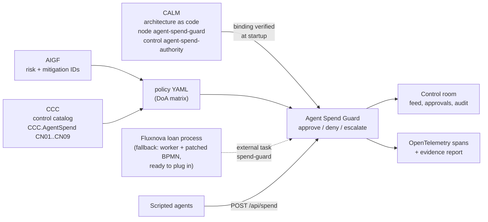

# Agent Spend Guard

**Hackathon Track:** AI Governance / Gov-as-Code (Steel Thread)

> *You measure spending. This controls it.*
> Deterministic controls bounding non-deterministic AI agents.

The FINOS Steel Thread governs *what* the loan agent decides, and it already measures token usage. Nothing governs *what the agent spends* getting there. Agent Spend Guard is that missing control: a policy enforcement point that every agent spend request (LLM tokens, paid data checks such as credit-bureau pulls) goes through. It returns **approve / deny / escalate-to-human**, the reason and the rule that fired.

The policy is a YAML file that reads like a bank's **delegation-of-authority (DoA) matrix**: signing limits, four-eyes, budgets per case, merchant restrictions, and agent-to-agent delegation where authority only narrows. A compliance control room shows live spend, the approval queue, a tamper-evident audit log and a per-case evidence report.

Judged as a live presentation.

## The FINOS projects working as one pipeline



| Project | How it is used here |
|---|---|
| **AIGF** | Every policy control cites AIGF risk and mitigation IDs (e.g. `AIR-SEC-024` Agent Action Authorization Bypass, `AIR-OP-028` Multi-Agent Trust Boundary Violations). We also draft one new risk and one new mitigation: [`finos/aigf/`](finos/aigf/). |
| **CALM** | [`loan-approval-with-spend-guard.calm.json`](finos/calm/loan-approval-with-spend-guard.calm.json) adds an `agent-spend-guard` node and an `agent-spend-authority` control. The control's requirement is the JSON Schema generated from our policy model. **On startup the guard verifies this binding** (the config is the policy actually loaded, the policy validates against the requirement, every control has AIGF refs and a CCC id) and refuses to start if it is broken. |
| **CCC** | [`agent-spend-controls.yaml`](finos/ccc/agent-spend-controls.yaml): one control per rule SG-01..SG-09 with threats, testable assessment requirements and a pointer to the test that proves it. |
| **Fluxnova** | Fallback: a worker, a patched Steel Thread BPMN and a mocked-engine test, ready to plug in. Not running in the Steel Thread; see below. |
| **OpenTelemetry** | One `spendguard.evaluate` span per decision (GenAI semantic-convention attributes plus `aigf.*`, `ccc.*`, `calm.*`), written to `data/traces.jsonl`. Example: [`sample-trace.json`](finos/traces/sample-trace.json). |
| **Evidence** | `GET /api/evidence/:caseId` produces an audit-ready report per case with AIGF, CCC and CALM refs, approvers, trace ids and chain verification. Example: [`sample-evidence-CASE-1005.md`](finos/evidence/sample-evidence-CASE-1005.md). |

### Fluxnova / Steel Thread: what is and is not done

**Done and tested:** an external task worker ([`fluxnova-worker.ts`](apps/guard/src/finos/fluxnova-worker.ts)), a patched `LoanApprovalProcess_AI` BPMN with an "Authorise agent spend" task and a `SPEND_DENIED` error path, and a test that runs the worker against a **mocked** engine REST API (approve, deny, escalate, expiry).

**Not done:** a run against the real Steel Thread stack. It was not attempted (it needs Java 21, Docker and the Steel Thread's own LLM API keys). The engine credentials, the BPMN in the Fluxnova Modeler and the worker against a live engine are all unverified. See the "Not yet verified" note in [`finos/fluxnova/README.md`](finos/fluxnova/README.md), which also has the exact steps to plug the guard in. The worker only starts when `FLUXNOVA_URL` is set, so the normal demo is unaffected.

## Installation and running the demo

Requirements: **Node 22 or newer** and npm. No API keys, Docker or database are needed: all vendors, prices and agents are mocked.

```sh
git clone https://github.com/finos-hack/fall-hackathon-2026-gamma
cd fall-hackathon-2026-gamma
npm install
npm run dev
```

This starts the guard API on <http://localhost:8080> and the control room on **<http://localhost:5173>**. Open the control room in a browser. It works on Windows, macOS and Linux.

If port 8080 is taken (the Steel Thread also uses it), run the two apps in separate terminals:

```sh
PORT=8088 npm run dev -w apps/guard
GUARD_URL=http://localhost:8088 npm run dev -w apps/control-room
```

(Windows PowerShell: `$env:PORT=8088; npm run dev -w apps/guard`.)

### Running the demo (about 3 minutes)

Use the **Demo** menu in the header. Each scenario starts from a fresh case. Press `d` to hide the menu for screenshots, and **Reset** to clear everything.

| Scenario | What happens | What to look at |
|---|---|---|
| **S1 Normal loan case** | Small spends (LLM, KYC, credit score). | All auto-approved. |
| **S2 Four-eyes** | A $28 full credit report exceeds the $25 four-eyes limit. | Approval queue: approve as **Sofia**, try Sofia again (rejected: same approver), switch "Acting as" to **Marco** and approve. |
| **S3 Structuring** | The agent splits a $9 purchase into three $3 purchases to stay under its $5 signing limit. | The third part is escalated as a split purchase and linked to the first two. Reject it as Sofia. |
| **S4 Delegation** | The loan agent grants the fraud helper $3. | The helper spends from the parent's budget; it cannot buy `fraud-check.enhanced` on the parent's authority and cannot sub-delegate. See the Agents tab. |
| **S5 Runaway agent** | The agent loops the same premium LLM call. | After 5 requests it is cut off, a red banner shows the projected $/hour, and later requests are denied. Click **Resume** as a human. |

Click any feed row to open the request drawer (rule trace, AIGF refs, CCC id, CALM control). The **Audit** tab exports CSV/JSON, shows "chain intact" and has the per-case **evidence report**. The header badge shows the FINOS chain (AIGF, CALM, CCC, Fluxnova).

You can also drive the guard without the UI:

```sh
curl -X POST localhost:8080/api/scenarios/S1/run      # S1..S5
curl localhost:8080/api/state                          # budgets, queue, recent requests
curl "localhost:8080/api/evidence/CASE-1005?format=md" # use the case id shown in the feed
curl localhost:8080/api/audit/verify
```

## The policy (a DoA matrix as code)

[`policies/loan-approval.policy.yaml`](policies/loan-approval.policy.yaml) is validated with zod; the JSON Schema is generated into `policies/spend-policy.schema.json`.

| Bank control | Agent Spend Guard rule |
|---|---|
| Signing limits / approval ceiling | SG-03: `autoApproveUpTo` / `escalateUpTo` per authority tier |
| Four-eyes principle | SG-04: two distinct approvers above `fourEyesAbove` |
| Merchant-category restriction | SG-01: service allow-list per agent |
| Cost-centre budget | SG-02: per-case and per-day budgets (pending approvals reserve budget) |
| AML structuring / smurfing detection | SG-05: split-purchase detection, grouped by root agent |
| Sub-delegation cannot exceed your own authority | SG-06: attenuation, shared budget |
| Card freeze | SG-07: runaway circuit breaker, human-only resume |
| Duplicate payment check | SG-08 |
| Audit trail for the second line of defence | SG-09: hash-chained, exportable log |

More detail: [docs/doa-mapping.md](docs/doa-mapping.md). The exact evaluation order, error codes and data model are in [`CLAUDE.md`](CLAUDE.md) (sections 2, 3 and 5).

## Development setup

```sh
npm install
npm test                 # Vitest, guard workspace (demo scenarios S1-S5 are tests)
npm run finos:validate   # CALM CLI check, policy vs schema, CCC coverage, AIGF ids
npm run gen:schema       # regenerate policy schema + CALM requirement from zod
npm run check:dco        # lists commits without a Signed-off-by trailer (prints nothing when clean)
npm run build            # build the control room
```

`finos:validate` runs the CALM CLI through `npx`, so it needs network access the first time and can take a while. It accepts the 18 known upstream `ai-steel-thread.local` requirement-URL errors plus our YAML `config-url` (the CLI only parses JSON configs); any other error fails.

Optional environment variables: `PORT` (guard port), `SPENDGUARD_STRICT=0` (downgrade a broken CALM binding to a warning), `FLUXNOVA_URL` (start the Fluxnova worker). Runtime data (`data/audit.jsonl`, `data/traces.jsonl`) is gitignored.

Layout: `apps/guard` (Fastify API, engine, FINOS code), `apps/control-room` (React + Vite + Tailwind), `policies/`, `finos/`, `docs/`.

## How it was built

Built solo in four days, spec-first with Claude Code. Short version (full story in [docs/how-it-was-built.md](docs/how-it-was-built.md)):

1. **One spec, [`CLAUDE.md`](CLAUDE.md), written before any code:** product, policy model, the exact evaluation pipeline and the five demo scenarios.
2. **One Claude Code session per task** from a checklist in that spec, each with a definition of done, a DCO-signed commit, and a fresh session for the next task.
3. **The spec's scenarios are the tests.** S1-S5 and the edge cases (budgets, duplicates, structuring across helpers, grant limits, audit tampering) are Vitest tests, so "done" means the tests pass.
4. **Model switching by difficulty.** Sonnet by default, Opus for the hard rules and for polish.
5. **Scope kept honest.** Everything external is mocked; ideas go to a "Later" list instead of the code.

## Roadmap

1. Run the guard against the real Steel Thread stack (Java 21 + Docker) and confirm `source: fluxnova` requests in the control room.
2. Live LLM mode, where a real Claude agent is governed through the guard (cut, not built).
3. Contribute the proposed risk and mitigation to AIGF and the controls to CCC.
4. Add the guard to the Steel Thread as a governed CALM node and send its spans to the Grafana/Tempo there.
5. Authorise-then-capture settlement with actual token usage, and a policy what-if simulator.

## Contributing

Coding agents should follow [AGENTS.md](./AGENTS.md), which requires a Developer Certificate of Origin sign-off on every commit.

**All commits** must be signed with a DCO signature to avoid being flagged by the DCO Bot. This means that your commit log message must contain a line that looks like the following one, with your actual name and email address:

```
Signed-off-by: John Doe <john.doe@example.com>
```

See [CONTRIBUTING.md](./CONTRIBUTING.md) for more information.

## License

Copyright 2026 FINOS

Distributed under the [Apache License, Version 2.0](http://www.apache.org/licenses/LICENSE-2.0).

SPDX-License-Identifier: [Apache-2.0](https://spdx.org/licenses/Apache-2.0)
